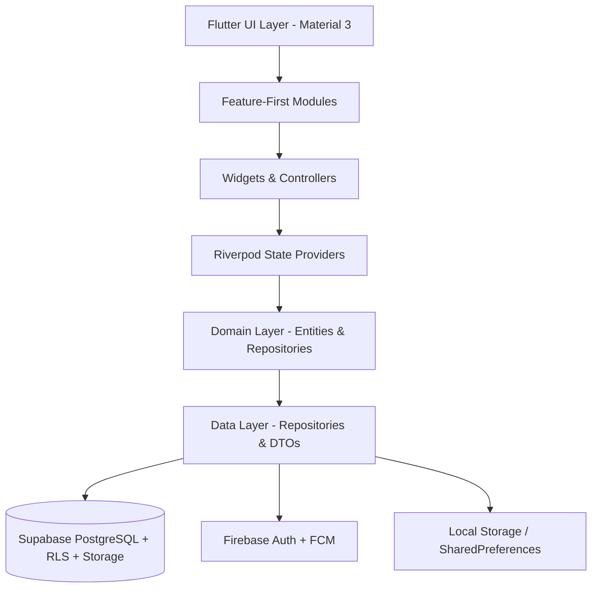

# LinguaCare (DLD Companion)

A comprehensive, supportive, and non-diagnostic cross-platform companion application designed for individuals affected by **Developmental Language Disorder (DLD)** and their support ecosystems—including **Parents, Teachers, Adults (18+), and Speech-Language Specialists (SLPs)**.

---

## 📑 Table of Contents

- [Overview & Clinical Philosophy](#-overview--clinical-philosophy)
- [Target User Roles & Capabilities](#-target-user-roles--capabilities)
- [Core Feature Modules](#-core-feature-modules)
- [System Architecture & Tech Stack](#-system-architecture--tech-stack)
- [Project Directory Structure](#-project-directory-structure)
- [Prerequisites & Environment Configuration](#-prerequisites--environment-configuration)
- [Getting Started & Installation](#-getting-started--installation)
- [Running the Application](#-running-the-application)
- [Troubleshooting & Common Build/Device Errors](#-troubleshooting--common-builddevice-errors)
- [Testing & Quality Assurance](#-testing--quality-assurance)
- [Privacy, Safety & Clinical Guardrails](#-privacy-safety--clinical-guardrails)
- [Roadmap & Documentation Index](#-roadmap--documentation-index)

---

## 🌟 Overview & Clinical Philosophy

**Developmental Language Disorder (DLD)** is a hidden, lifelong neurodevelopmental condition affecting roughly 1 in 14 children (around 7% of the population). Despite its prevalence, DLD remains widely under-diagnosed and misunderstood:
- Children who develop coping mechanisms or masking strategies are frequently overlooked.
- Parents, educators, and speech therapists often work in operational silos with minimal carry-over between home, classroom, and clinic.
- Families in low-resource or geographically remote settings face immense barriers in accessing formal speech pathology assessments.

### Clinical Non-Diagnostic Guardrails
> [!IMPORTANT]
> **LinguaCare is not a diagnostic device and does not provide autonomous clinical diagnoses.**
> The app acts as an early warning screening tool, language domain profiler, intervention tracker, and collaborative workspace. All clinical classifications and formal diagnoses must be confirmed by a licensed Speech-Language Pathologist or qualified clinician.

---

## 👥 Target User Roles & Capabilities

LinguaCare is customized dynamically based on the active authenticated user persona:

| Persona | Primary Target | Core Capabilities & Value Proposition |
|---|---|---|
| **Speech-Language Specialist (SLP)** | Licensed clinicians, therapists | Caseload management, assigning targeted home/school activity plans, clinical observation reviews, progress validation, and diagnostic tracking. |
| **Parent / Caregiver** | Parents of children (Bands: 5–11 & 11–18) | Standardized screening questionnaires, guided daily language exercises, home carry-over tasks, shared progress journal, and specialist linking. |
| **Teacher / SENCO** | Classroom teachers, special education staff | Classroom behavioral & language observation logs, individualized educational accommodations, strategy library, and real-time parent sync. |
| **Adult (18+)** | Independent adults living with DLD | Self-paced communication practice, personalized Digital Communication-Needs Card (workplace/social), confidence journaling, and compensatory strategies. |

---

## 🧩 Core Feature Modules

1. **Learn (Psychoeducation Library)**
   - Evidence-based articles, debunked myths, developmental milestones, and classroom accommodation toolkits.
   - Offline-capable with local asset bundle caching.

2. **Screen (Multi-Tier Screening Pipeline)**
   - **Tier 1:** Standardized developmental screening questionnaire.
   - **Tier 2:** Interactive in-app child language activities (expressive vocabulary, sentence recall, grammar comprehension).
   - **Tier 3:** Clinician review workflow with specialist-confirmed labels and language domain radar charts.

3. **Practise (Language Skill Engine)**
   - Targeted daily micro-activities spanning vocabulary acquisition, narrative retelling, instruction-following, syntax structures, and pragmatic conversation.

4. **Track & Progress Visualizations**
   - Interactive charts powered by `fl_chart`.
   - Milestone tracking, longitudinal fluency metrics, and communication journal entries.

5. **Collaborate (Multi-Stakeholder Sync)**
   - Secure invitation and linking between Parents, Teachers, and Specialists.
   - Granular role-based access control and read/write permissions.

6. **Support Tools**
   - Visual Schedule Builder.
   - Workplace & Social Communication-Needs Card.
   - Complex sentence and instruction simplifier.

---

## 🏗️ System Architecture & Tech Stack

The project follows a **Feature-First Clean Architecture** with Riverpod for state management and GoRouter for declarative routing.



### Technology Highlights

- **Framework:** Flutter SDK (`^3.13.0`+) with Dart 3
- **Design System:** Material Design 3, dynamic typography via `google_fonts`, Lottie animations (`lottie: ^3.6.1`)
- **State Management:** Riverpod (`flutter_riverpod: ^3.4.3`)
- **Navigation:** GoRouter (`go_router: ^18.1.0`) with role guards and deep-linking support
- **Authentication:** Firebase Authentication (`firebase_auth: ^7.0.0`) & Google Sign-In (`google_sign_in: ^7.2.0`)
- **Backend & Database:** Supabase (`supabase_flutter: ^2.18.3`) with PostgreSQL, Row Level Security (RLS), and Edge Functions
- **Data Visualizations:** `fl_chart: ^0.70.2`
- **Internationalization:** `flutter_localizations` with ARB configuration (`l10n.yaml`)

---

## 📂 Project Directory Structure

```text
d:\DLD/
├── android/                 # Android native project and Gradle setup
├── assets/                  # Content assets, JSON matrices, and Lottie animations
│   ├── activities/v1/       # Activity definitions and content
│   ├── content/v1/          # Educational content JSON bundles
│   └── screening/v1/        # Screening questionnaire definitions
├── docs/                    # In-depth architectural & clinical documentation
│   ├── 01_PRD.md            # Product Requirements Document
│   ├── 03_Roles_Permissions.md
│   ├── 05_Auth_Architecture.md
│   ├── 06_Tech_Stack_Architecture.md
│   ├── 07_Database_Schema.md
│   ├── 12_Android_Studio_Setup.md
│   ├── 13_Screening_Differential_Pipeline.md
│   ├── 14_AI_ML_Plan.md
│   └── SETUP.md
├── env/                     # Environment configuration JSONs (gitignored)
│   ├── dev.example.json     # Template for local dev environment
│   └── dev.json             # Active dev credentials
├── lib/
│   ├── app/                 # App-level routing and theming
│   │   ├── router/          # GoRouter configuration and guards
│   │   └── theme/           # Color palettes, typography, theme data
│   ├── core/                # Shared utilities, widgets, error handling
│   │   ├── errors/          # Custom exceptions & ConfigErrorScreen
│   │   └── widgets/         # Reusable design system components
│   ├── data/                # Data sources, Supabase client, repositories
│   ├── domain/              # Business entities and interfaces
│   ├── features/            # Feature-first modular code
│   │   ├── activities/      # Exercise engine & interactive tasks
│   │   ├── adult/           # Adult-specific dashboard & needs card
│   │   ├── auth/            # Sign in, register, OTP verification
│   │   ├── goals/           # SLP/Parent goal creation and tracking
│   │   ├── learn/           # Psychoeducation library
│   │   ├── observations/    # Teacher & parent observation logs
│   │   ├── onboarding/      # First-launch introduction flow
│   │   ├── parent/          # Parent home, child profile switcher
│   │   ├── role_setup/      # Initial persona onboarding selection
│   │   ├── screening/       # 3-tier screening engine
│   │   ├── settings/        # Privacy, theme, consent, data export
│   │   ├── sharing/         # Multi-stakeholder links & invites
│   │   ├── specialist/      # Clinician dashboard & caseload management
│   │   ├── splash/          # Animated splash screen
│   │   └── teacher/         # Teacher classroom strategies
│   ├── firebase_options.dart# Firebase cross-platform configuration
│   └── main.dart            # Application entrypoint & bootstrapping
├── pubspec.yaml             # Dependencies and Flutter asset declarations
└── README.md                # Project documentation
```

---

## ⚙️ Prerequisites & Environment Configuration

### 1. Prerequisites
- **Flutter SDK:** Version 3.13.0 or later (`flutter doctor` must be clean)
- **Java Development Kit:** JDK 17 (recommended for modern Android Gradle Plugin compatibility)
- **Android Studio / Command Line Tools:** Android SDK Build-Tools 34 or 35 (Avoid unfinalized Build-Tools 36 previews)
- **Connected Device:** Physical Android device with USB Debugging enabled, or Android Emulator (API 33+)

### 2. Environment Variables Setup
The application reads configuration parameters at compile/runtime using Flutter's `--dart-define-from-file` flag.

1. Ensure a file named `env/dev.json` exists in the project root:
   ```json
   {
     "SUPABASE_URL": "https://<your-project-ref>.supabase.co",
     "SUPABASE_ANON_KEY": "<your-supabase-anon-jwt-key>"
   }
   ```
2. Verify that `SUPABASE_URL` matches standard Supabase formatting:
   `https://[20-char-alphanumeric].supabase.co` with no trailing slashes or subpaths.

---

## 🚀 Getting Started & Installation

1. **Clone the repository:**
   ```bash
   git clone <repository_url>
   cd DLD
   ```

2. **Fetch Flutter dependencies:**
   ```bash
   flutter pub get
   ```

3. **Verify connected devices:**
   ```bash
   flutter devices
   ```

---

## 📱 Running the Application

### Running with Active Configuration (Recommended)
Always pass the configuration file when launching:

```bash
flutter run -d <DEVICE_ID> --dart-define-from-file=env/dev.json
```

*Example for physical device:*
```bash
flutter run -d RZCX824PR5R --dart-define-from-file=env/dev.json
```

### Running on Other Platforms
- **Windows Desktop:**
  ```bash
  flutter run -d windows --dart-define-from-file=env/dev.json
  ```
- **Web (Chrome):**
  ```bash
  flutter run -d chrome --dart-define-from-file=env/dev.json
  ```

---

## 🛠️ Troubleshooting & Common Build/Device Errors

### 1. `INSTALL_PARSE_FAILED_UNEXPECTED_EXCEPTION` / `AAPT dump failed`
- **Symptom:**
  ```text
  adb.exe: failed to install app-debug.apk: Failure [INSTALL_PARSE_FAILED_UNEXPECTED_EXCEPTION: Failed to parse ... base.apk: AndroidManifest.xml]
  ERROR: dump failed because resource AndroidManifest.xml not found
  ```
- **Root Cause:**
  Using an unstable/preview release of Android SDK Build-Tools (e.g., `build-tools/36.1.0`) or interrupted builds that produce corrupt APK resources.
- **Resolution:**
  1. Open Android Studio → **SDK Manager** → **SDK Tools**.
  2. Check "Show Package Details".
  3. Ensure a stable version (e.g., **34.0.0** or **35.0.0**) is installed, and uninstall any experimental `36.x` versions.
  4. Perform a full clean rebuild:
     ```bash
     flutter clean
     flutter pub get
     flutter run -d <DEVICE_ID> --dart-define-from-file=env/dev.json
     ```

### 2. `Failed to remove .dart_tool` during `flutter clean`
- **Symptom:** Windows reports that a file in `.dart_tool` is locked or in use by another process.
- **Root Cause:** An active Dart Analysis Server, Android Studio instance, or background `flutter run`/`flutter logs` process is holding a lock on cache files.
- **Resolution:**
  Kill hanging Dart/Gradle processes before running clean:
  ```powershell
  Stop-Process -Name dart -Force -ErrorAction SilentlyContinue
  Stop-Process -Name java -Force -ErrorAction SilentlyContinue
  flutter clean
  ```

### 3. Missing Supabase Configuration Screen
- **Symptom:** App launches but displays a red/orange screen stating:
  *"Missing Supabase URL or Anon Key. Please ensure env/dev.json is provided via --dart-define-from-file."*
- **Root Cause:** Launching the app via standard `flutter run` without `--dart-define-from-file=env/dev.json`.
- **Resolution:** Always add the flag in the CLI or update `.vscode/launch.json` / Android Studio Run Configurations with `toolArgs: ["--dart-define-from-file=env/dev.json"]`.

### 4. Impeller Vulkan / `gralloc4` Buffer Allocation Warnings on Android 15
- **Symptom:**
  ```text
  E/gralloc4: Invalid base format! req_format = 0x3b ...
  E/GraphicBufferAllocator: Failed to allocate (4 x 4) ...
  ```
- **Root Cause:**
  Flutter's Impeller Vulkan rendering engine probing unsupported surface formats on certain MediaTek/Exynos hardware under Android 15.
- **Resolution:**
  These are non-fatal driver negotiation logs. If visual artifacts occur, Impeller can temporarily be toggled in `android/app/src/main/AndroidManifest.xml` via `<meta-data android:name="io.flutter.embedding.android.ImpellerBackend" android:value="opengles" />`.

---

## 🧪 Testing & Quality Assurance

Run the test suite across units and widgets:

```bash
# Run all unit and widget tests
flutter test

# Run specific screening test
flutter test test/content_unit_test.dart

# Run linter and static analysis
flutter analyze
```

---

## 🛡️ Privacy, Safety & Clinical Guardrails

1. **No Autonomous Diagnoses:** Explicit clinical disclaimers are presented throughout all screening touchpoints.
2. **Minimal Data Collection:** No personal child identifiable information (PII) is logged or transmitted to telemetry services.
3. **Row-Level Security (RLS):** Supabase database tables enforce strict tenant and role-based policies; parents and teachers can only view data explicitly shared with them.
4. **Consent Management:** Clinicians and researchers can only access anonymized case profiles if explicit digital consent is recorded from the legal guardian.

---

## 📚 Documentation Index

For detailed clinical rationale, database schemas, and architectural designs, consult the [docs/](file:///d:/DLD/docs) directory:
- [01 · Product Requirements Document (PRD)](file:///d:/DLD/docs/01_PRD.md)
- [02 · DLD Domain Knowledge & Evidence Base](file:///d:/DLD/docs/02_DLD_Domain_Knowledge.md)
- [03 · Roles, Permissions & Consents](file:///d:/DLD/docs/03_Roles_Permissions.md)
- [05 · Auth Architecture & Security](file:///d:/DLD/docs/05_Auth_Architecture.md)
- [06 · Tech Stack & Architectural Clean Design](file:///d:/DLD/docs/06_Tech_Stack_Architecture.md)
- [07 · Database Schema & RLS Policies](file:///d:/DLD/docs/07_Database_Schema.md)
- [12 · Android Studio & Development Setup](file:///d:/DLD/docs/12_Android_Studio_Setup.md)
- [13 · Screening & Differential Pipeline](file:///d:/DLD/docs/13_Screening_Differential_Pipeline.md)
- [14 · AI/ML Research & Clinical Labeling Plan](file:///d:/DLD/docs/14_AI_ML_Plan.md)
