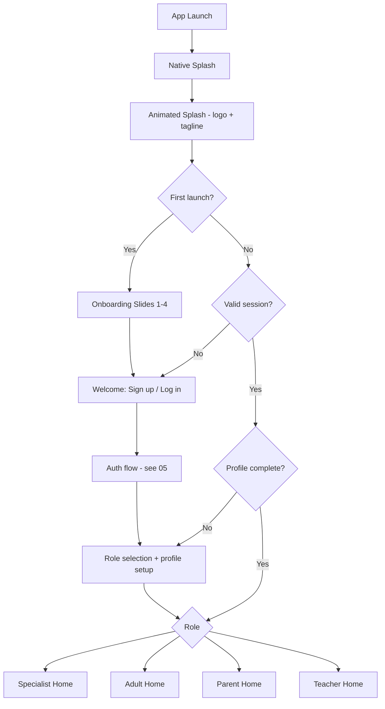

# 04 · App Flow, User Flows & Navigation

## 1. Master App Flow

## 2. Splash & Onboarding
| Screen | Content | Motion |
|---|---|---|
| Native splash | Brand colour + logo (Android 12 SplashScreen API, iOS LaunchScreen) | none |
| Animated splash (1.5–2 s) | Logo draws in, tagline fades "Every voice, understood" | Lottie / Rive, ease-out |
| Slide 1 | "Understand DLD" – illustration | parallax illustration, text fade-up |
| Slide 2 | "Spot early signs" | icon morph |
| Slide 3 | "Practise a little, every day" | progress ring fills |
| Slide 4 | "Work together – parents, teachers, specialists" | avatars connect with line |
| Controls | Skip, dots indicator, Next → Get Started | page-indicator spring animation |
> Respect **reduce-motion** system setting: replace with fades/static.

## 3. Role Selection & Profile Setup
1. Choose role (4 cards).
2. **Specialist:** name, profession, licence no./body, country, workplace → "pending verification".
3. **Adult:** name, DOB (18+ gate), preferences (font size, reading aid, language).
4. **Parent:** parent name → *Add child* (nickname, DOB → auto band 5–11 / 11–18, interests, home language(s), concerns) → consent screens.
5. **Teacher:** name, school, grade/subject, optional school email.
6. Consent: Terms, Privacy, data-use, voice-data opt-in (separate toggle).

## 4. Role Home Screens (bottom nav, 4–5 tabs)
- **Parent:** Home · Practise · Learn · Progress · Family (children, linked pros)
- **Teacher:** Home · Students · Strategies · Observations · Learn
- **Adult:** Home · Practise · Learn · Journal · Me
- **Specialist:** Dashboard · Clients · Plans · Library (Messages dropped for v1)

## 5. Key User Flows
### 5.1 Parent – Screening → Action
Home → *Check language* → choose child → age-banded checklist (short, 1 question/screen) → result band (*No concerns noted / Some signs / Consider assessment*) → explain + non-diagnostic notice → CTAs: *Share with teacher*, *Find a specialist*, *Start daily activities*.

### 5.2 Parent – Daily Practice
Home → *Today's 10-min plan* → activity (instruction card, activity, parent tips, "how did it go?") → reward animation → log → progress update.

### 5.3 Teacher – Observation to Support
Students → select student → *Add observation* (structured tags + free note + date) → app suggests accommodations → *Share with parent / specialist*.

### 5.4 Specialist – Caseload
Clients → add/accept client → baseline notes → create goals → assign activities → review weekly summary → send feedback to parent.

### 5.5 Linking / Invite
Parent → Family → *Invite teacher/specialist* (email or code) → recipient accepts → parent picks scope → access active (revocable).

### 5.6 Adult – Communication Card
Me → *My communication card* → pick needs ("Give me extra time", "Write it down") → share as image/QR.

## 6. Navigation Rules
- `go_router` with role-based route guards.
- Deep links: invite codes, password reset, email verify.
- Tablets/foldables: bottom nav → NavigationRail at ≥ 600 dp; two-pane master-detail at ≥ 840 dp.

## 7. Phase 5 Completed (Local-Only Tools & Info Screens)
- Local Store, Visual Schedule Builder, Instruction Simplifier, Communication Cards, Adult Journal, Info & Trust screens.

## 8. Phase 6 Completed (Security Hardening, Release Readiness & Performance)
- **Database Security**: Fixed observation UPDATE policy hole (`20260301000022_fix_observation_update_policy.sql`), re-locked session updates, added `search_path` on SECURITY DEFINER functions, and created `phase6_rls_checks.sql` policy tests.
- **Release Build Safety**: Configured ProGuard keep rules for SharedPreferences in `proguard-rules.pro`, added `key.properties.template`, and set `GoogleFonts.config.allowRuntimeFetching = false;`.
- **Code Health**: Fixed all analyzer warnings/infos (`flutter analyze` reports 0 issues), added `updateObservation` repository method.
- **Performance**: Optimized app startup and widget tree immutability.
