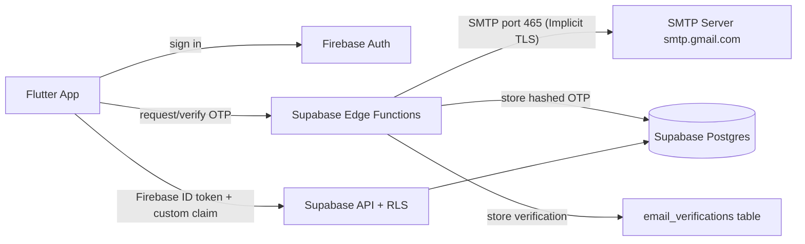

# 05 · Authentication & Security Architecture

## 1. Requirements
Firebase Authentication · Email/password · **Email OTP verification via SMTP over port 465** · Password reset · Continue with Google · Supabase DB · free tier.

## 2. Design Decisions (Phase 2A & SMTP Update)
1. **SMTP over Port 465:** OTP emails are sent via SMTP using implicit TLS on port 465 (`smtp.gmail.com`) from Supabase Edge Functions. (Note: Ports 25 and 587 are blocked on the platform).
2. **Email Verification Source of Truth:** `email_verifications` table keyed by Firebase UID. Since profiles cannot be created before role selection, verified emails are recorded here first. Google sign-in users are automatically marked verified when the Firebase token has `email_verified=true`.
3. **Custom Claims for RLS:** Supabase RLS relies on `auth.jwt()->>'role' = 'authenticated'`. The `set-claims` Edge Function sets custom claim `role="authenticated"` via the Firebase Identity Toolkit REST API using a Firebase Service Account secret (`FIREBASE_SERVICE_ACCOUNT`). The app must force-refresh its ID token afterwards.
4. **Token-derived Email:** The email address used for OTP generation is always extracted from the verified Firebase ID token, never accepted from the request body.

## 3. Components


## 4. Flows
### 4.1 Sign-up (email + password + OTP)
1. App → `createUserWithEmailAndPassword` (Firebase).
2. App → Edge Function `set-claims` (sets custom claim `role="authenticated"`).
3. App forces token refresh.
4. App → Edge Function `send-otp` (auth: Firebase ID token; extracts email from token).
5. Function generates 6-digit code, stores **hash (SHA-256 + pepper + uid)** + expiry (10 min) + attempts, and sends via SMTP (port 465).
6. User enters OTP → Edge Function `verify-otp {code}`.
7. Function verifies hash/expiry/attempts, marks consumed, and upserts `email_verifications` row.
8. App proceeds to role setup and profile creation.

### 4.2 Login
Email + password → check email verification status → if unverified, request OTP → else load profile → role home.

### 4.3 Continue with Google
`google_sign_in` → Firebase credential → (Google emails are pre-verified, `email_verified=true`) → `send-otp` automatically marks verified → profile exists? yes → home, no → role selection.

## 5. OTP Security Rules & Secrets Management
- 6 digits, CSPRNG (`crypto.getRandomValues`), **hashed (SHA-256 + pepper + uid)** in DB, never logged.
- Expiry 10 min; max 5 attempts per code; resend cooldown 60s; max 5 sends/hour/uid.
- Generic error messages (no account enumeration).
- Service-account key & SMTP secrets stored securely in Supabase **secrets**, never in client code.

### Required SMTP Secrets (Set via Supabase CLI)
- `SMTP_HOST` (e.g., `smtp.gmail.com`)
- `SMTP_PORT` (`465`)
- `SMTP_USER` (sender email)
- `SMTP_PASSWORD` (Gmail App Password)
- `SMTP_FROM_NAME` (e.g., `LinguaCare`)
- `SMTP_FROM_EMAIL` (optional, defaults to `SMTP_USER`)

### Management Commands
```bash
# Set secrets from env file
supabase secrets set --env-file supabase/.env.secrets

# Unset legacy Brevo secrets if any
supabase secrets unset BREVO_API_KEY BREVO_SENDER_EMAIL BREVO_SENDER_NAME

# Deploy Edge Function
supabase functions deploy send-otp
```
