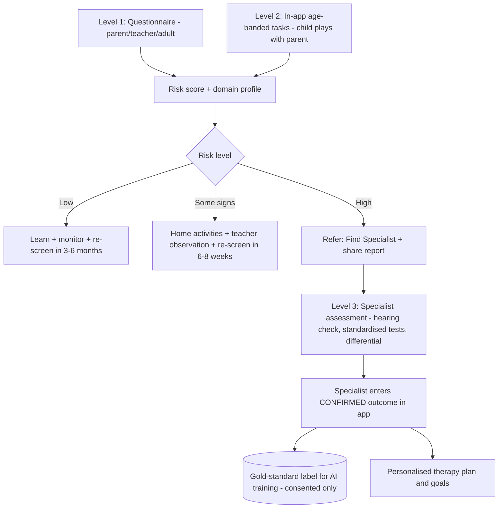

# 13 · Screening, "Which Area?" Profiling & Referral Pipeline  *(NEW)*

## 1. Honest scope: what the app can and cannot do
| The app CAN | The app CANNOT |
|---|---|
| Flag **risk level** (low / some signs / high) for language difficulty | Give a medical **diagnosis** of DLD |
| Show a **domain profile** (understanding, vocabulary, grammar, narrative, conversation) | Say "this child has disorder X" as a fact |
| Raise **"also check"** flags (hearing, speech sounds, reading, attention, social-communication) | Rule out hearing loss, autism, intellectual disability, etc. |
| Route the family to a qualified specialist and record the **specialist-confirmed** result | Replace a speech-language assessment |

**Why:** DLD is a diagnosis of exclusion made by a qualified clinician (language testing + hearing check + ruling out other causes). Software that outputs a diagnosis may also be regulated as a medical device (e.g., CDSCO in India, FDA in the US) — get legal advice before any diagnostic claim.

## 2. Three-level pipeline


## 3. Level 1 – Questionnaires
- Age-banded (3–5*, 5–11, 11–18, adult). *pending your decision on preschool band.
- 15–25 items, 1 per screen, 3–4 answer choices ("never / sometimes / often").
- Separate parent and teacher versions (cross-setting agreement strengthens signal).
- Content built from Q11–20, 44–47 of your question set; **SLP must design/validate**. Standard clinical tools (e.g., CELF, CCC-2) are copyrighted — do not copy; license them or create original items validated against them.

## 4. Level 2 – In-app child tasks (5–11 / 11–18)
| Domain | Task idea | Signal captured |
|---|---|---|
| Understanding | "Touch the big red ball then the small dog" (1–3 step) | correct/incorrect, response time |
| Vocabulary | picture naming / pick-the-word | accuracy, word-finding hesitations |
| Grammar | choose the correct sentence / complete the sentence | accuracy by structure |
| Narrative | sequence 4 pictures, retell (audio opt-in) | order accuracy, retell length |
| Conversation (teen/adult) | scenario multiple-choice (idioms, intent) | accuracy |
- Tasks are **game-like, short (≤10 min), no timers shown, pause always visible**.
- Parent present; parent can mark "child was distracted / tired" → session flagged low-quality.
- Multilingual: task items per home language; never penalise for mixing languages.

## 5. Output: Language Profile Report (not a diagnosis)
```
Risk level: Some signs
Strengths: vocabulary, listening to short instructions
Areas to watch: grammar (past tense), retelling stories
Also worth checking with a professional: hearing test (recommended for every referral)
Confidence: Medium (2 of 3 sources agree)
Notice: This is a screening result, not a diagnosis.
```
**"Also check" flags (rule-based, from questionnaire answers):** hearing concerns · unclear speech sounds · reading/spelling difficulty · attention/restlessness · social-communication differences · exposure to multiple languages. These suggest *which professional to see*, never a label.

## 6. Level 3 – Specialist confirmation (the only source of "confirmed")
Specialist enters: assessment date, tools used, hearing status, languages assessed, **outcome** (`typical` / `language_difficulty_DLD` / `language_difficulty_other_cause` / `speech_sound_disorder` / `other`), domains affected, severity, notes. Stored as `clinical_assessments` (see `07` addendum). Parent consent required to share.

## 7. Re-screening & Monitoring
Auto-reminders at 6–8 weeks (some signs) or 3–6 months (low). Trend chart per domain. Triggers for urgent referral: loss of previously acquired language, hearing concerns, rapid decline.

## 8. Result Wording Rules
Use "signs that may be worth discussing with a professional". Never "your child has/does not have". Show strengths first. Provide a printable one-page summary for the clinician.
