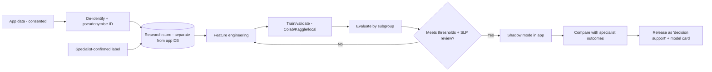

# 14 · AI / ML Plan – Learning from Confirmed Cases  *(NEW)*

## 1. Goal
Improve the app's **screening accuracy** (better risk flags and domain profiles) by learning from data of children whose outcome was **confirmed by a specialist** — with consent, ethics and safety controls. The model is a **decision-support aid**, never an autonomous diagnoser.

## 2. Critical rules
1. **Labels must come from clinicians**, not from the app's own output (otherwise the model just learns its own mistakes).
2. **Controls are required:** include children with typical development and children with other conditions. Training only on "identified DLD" children would make a model that says "DLD" for everyone.
3. **Separate opt-in research consent** (parent) + child assent (age-appropriate); app works fully if declined. Withdrawal must delete future use and, where feasible, past data.
4. **Ethics approval** (IRB/institutional ethics committee) before any research use; legal review of DPDP Act 2023 (India) and other markets.
5. **Never train on raw identifiable data.** De-identify; strip names, DOB→age in months, location→region.
6. **Human in the loop:** model output is shown to specialists as "suggestion"; parents see only the standard risk/profile report.
7. **No public "AI diagnosed" claims** until clinically validated.

## 3. Data to collect (only with research consent)
| Type | Examples | Sensitivity |
|---|---|---|
| Questionnaire answers | item-level responses (parent/teacher) | Medium |
| Task performance | accuracy, response time, error types per domain | Medium |
| Context | age in months, home language(s), schooling, hearing status | Medium |
| Audio (optional, separate toggle) | retell/naming clips | **High** – store encrypted, short retention, extract features then delete raw where possible |
| Gold label | specialist-confirmed outcome + domains + severity | High |

## 4. Pipeline

## 5. Modelling roadmap
| Stage | Model | Needs |
|---|---|---|
| 0 (now) | **Rule-based scoring** from validated cut-offs | no ML data |
| 1 | Logistic regression / gradient boosting on questionnaire + task features | ~hundreds of labelled cases incl. controls |
| 2 | Add audio features (speech rate, pauses, MLU, grammar errors) via speech tools | thousands of clips; atypical-speech ASR is unreliable → human/clinician review first |
| 3 | Multilingual / sequence models | large diverse dataset, funding |
> Be realistic: collecting enough **confirmed, diverse, consented** cases takes months/years. Consider partnering with a university or hospital SLP department.

## 6. Evaluation (must-have)
- Report **sensitivity, specificity, PPV/NPV, AUC, calibration** — not just accuracy.
- Evaluate **by subgroup**: age band, gender, home language, bilingual vs monolingual, socio-economic proxy, device type. A model that misses bilingual children must not ship.
- Prefer **high sensitivity** at screening stage (few missed cases) with transparent false-positive rate.
- External validation on data from a different clinic/region.
- Prospective **shadow-mode** trial: model runs silently, compared with specialist outcomes.
- Document in a **Model Card** (intended use, data, limits, metrics, version).

## 7. Free-tier / infra guidance
- Supabase free DB is small → keep research data in a **separate** secure store (encrypted export, university server, or private cloud bucket), not the app DB.
- Train on Google Colab / Kaggle / local machine with **de-identified** exports only.
- Serve the rule-based/ML scorer via Supabase Edge Function or on-device (TFLite) for offline use; version every model.

## 8. Bias, Fairness, Safety
Multilingual norms · dialect/accent diversity · avoid penalising code-switching · test with children with motor/speech differences · monitor drift · clear escalation if model & parent concern disagree (trust the concern → refer).

## 9. Governance
Data Protection Officer role · data-access log · retention schedule · annual ethics review · dataset versioning · incident response plan · publish plain-language "How we use data" page.
